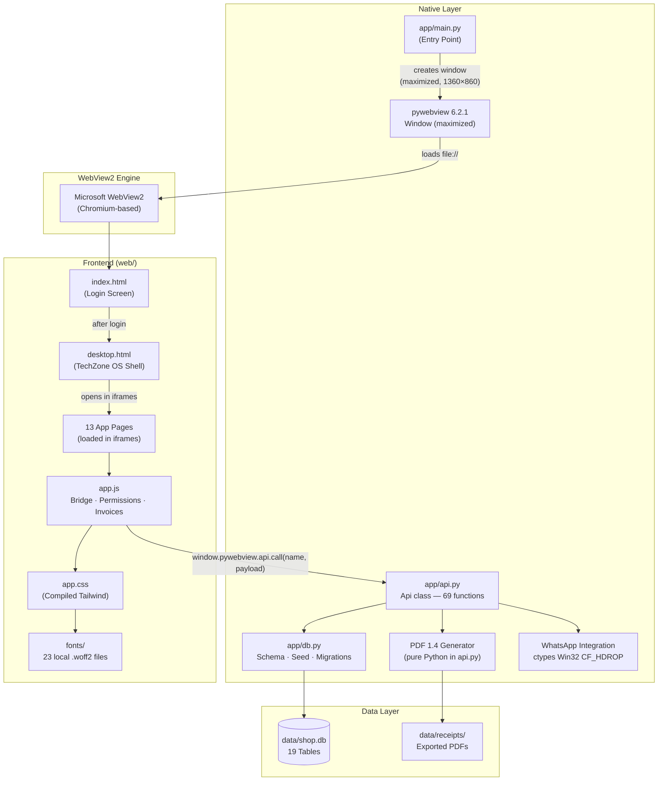
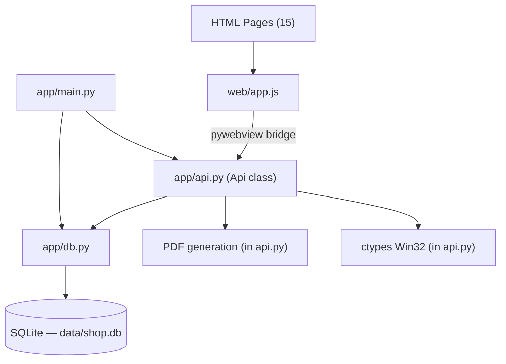

# TechZone POS — System Architecture

## Overview

TechZone is a fully offline point-of-sale and shop management system purpose-built for Egyptian electronics retailers. It runs as a single-window desktop application powered by Python 3.13, `pywebview` 6.2.1 (backed by Microsoft WebView2), and a vanilla HTML/CSS/JS frontend styled with compiled Tailwind CSS. All data lives in a local SQLite database (`data/shop.db`); the application requires no network connection at runtime.

The user interface emulates a hybrid desktop operating system ("TechZone OS") that blends Windows 11 and macOS design language — complete with a taskbar, Start menu, Dock, draggable desktop icons, and resizable floating windows — all rendered inside a single native window.

---

## System Diagram



---

## Entry Point — `app/main.py`

`main.py` is the sole entry point for the application. On launch it:

1. Imports `app.db` to ensure the database schema exists and runs any pending auto-migrations.
2. Reads `settings.store_name` from the database to set the native window title (e.g., "تك زون للإلكترونيات").
3. Resolves the application icon — `icon.ico` at the project root (or inside `sys._MEIPASS` when frozen).
4. Creates a single `webview.create_window()` instance:
   - **Size:** maximized (`maximized=True`), default 1360 × 860, minimum 360 × 500.
   - **URL:** `web/index.html` loaded via the `file://` protocol.
   - **JS API:** An instance of the `Api` class from `app/api.py` is bound to `window.pywebview.api`.
5. Calls `webview.start(icon=icon_path)` which hands control to the WebView2 event loop.

When packaged with PyInstaller (`sys.frozen` is `True`), `web/` assets are read from `sys._MEIPASS` (the temporary extraction directory) while `data/` is resolved relative to the executable's directory on disk.

---

## Frontend Architecture

### Page Inventory (15 pages)

| Page | Role |
|------|------|
| `index.html` | Smart login screen — shows store name/logo, accepts PIN-only by default |
| `desktop.html` | TechZone OS shell — taskbar, Start menu, Dock, floating windows, desktop icons |
| `pos.html` | Point-of-sale cashier screen |
| `sales_quotes.html` | Sales management, quotations, and invoice template designer |
| `history.html` | Sales and returns history |
| `customers.html` | Customer management and accounts receivable (full-screen) |
| `customer_details.html` | Individual customer account statement (full-screen) |
| `inventory.html` | Product catalog and stock management |
| `repair.html` | Repair/service ticket management |
| `buy_used.html` | Used device purchasing |
| `receipt.html` | Invoice/receipt preview, print, and WhatsApp sharing |
| `settings.html` | System settings (3 tabs: store, login, invoice designer) |
| `staff.html` | Employee management and per-user permission assignment |
| `profile.html` | Personal profile and per-user desktop preferences |
| `reports.html` | Financial reports and analytics |

### Loading and Navigation

- Every page includes `web/app.js` and `web/app.css`.
- `desktop.html` acts as the OS shell after login; application pages open inside `<iframe>` elements rendered as floating, resizable windows.
- Navigation between pages never leaves the single `pywebview` native window — the shell manages iframe sources.

### `web/app.js` (≈ 1 400 lines)

The shared JavaScript module provides:

| Subsystem | Purpose |
|-----------|---------|
| **Bridge** (`api(name, payload)`) | Wraps `window.pywebview.api.call(name, payload)`. Automatically detects whether it runs inside an iframe and resolves the bridge from the parent frame. Falls back to an HTTP POST mock (`/api/call`) only when running under a plain browser for screenshot tooling — never in production. |
| **Permissions** (`hasPerm(key)`) | Client-side guard that mirrors the 16 server-side permission keys. Pages hide or disable UI elements based on the current user's permission set returned by `session`. |
| **Theme sync** (`applyThemeEverywhere`) | Propagates light/dark mode changes to `desktop.html` and every open iframe simultaneously. `applyAccentColorEverywhere` does the same for the user's chosen accent colour. |
| **Invoice rendering** | `buildA4InvoiceHtml()` and `buildPosThermalReceiptHtml()` generate complete HTML documents for A4 and 80 mm/58 mm thermal receipts. `renderA4DocumentToJpeg()` and `renderInvoiceToJpeg()` rasterise them. `sendInvoicePdfToWhatsapp()` and `sendQuoteOrA4PdfToWhatsapp()` trigger Python-side PDF generation and Win32 clipboard injection. |
| **Page init** (`pageInit`) | Bootstraps every page: fetches the session, checks permissions, applies theme, loads page-specific data. |

### `web/app.css` and Tailwind

- `web/tailwind.css` is the Tailwind source containing `@font-face` declarations for 23 local `.woff2` files (Arabic + Latin).
- `web/app.css` is the compiled output. It is **committed to Git intentionally** because there is no build toolchain at runtime — no bundler, no Node.js dependency.

### Fonts and Icons

All fonts and Material Symbols icons are served from `web/fonts/` as `.woff2` files. Zero network requests are made; the application is fully air-gapped.

---

## Backend Architecture

### `app/api.py` — The Api Class (≈ 3 500 lines)

A single Python class, `Api`, exposes every backend operation to the frontend. The class contains **69 public methods** covering:

- Session management (`login`, `logout`, `session`, `login_config`)
- User/staff CRUD (`users_list`, `user_save`, `user_delete`, `profile_save`)
- Products and inventory (`products_search`, `product_save`, `product_delete`, `stock_adjust`)
- Serial number tracking (`serial_add`, `serial_list`)
- Sales workflow (`sale_create`, `sale_return`)
- Quotations (`quote_save`, `quote_convert`)
- Customer accounts (`customer_save`, `customer_payment`, `customer_statement`)
- Shifts (`shift_open`, `shift_close`, `shift_report`)
- Repairs (`repair_save`, `repair_status_update`)
- Used device purchases (`used_purchase_save`)
- Reports and analytics (`report_daily`, `report_monthly`, `report_top_products`)
- Settings (`settings_get`, `settings_save`, `pos_categories_config_save`)
- PDF generation and WhatsApp sharing (`generate_receipt_pdf`, `send_pdf_to_whatsapp`)
- Invoice template management

#### Dispatcher: `call(name, payload)`

The frontend invokes every API method through a single entry point:

```
window.pywebview.api.call("sale_create", { items: [...], customer_id: 5 })
```

`call()` in Python looks up the method by `name` on the `Api` instance and passes `payload` (a dict) as keyword arguments. This keeps the bridge surface minimal (one exposed function) while supporting an unlimited number of backend operations.

#### Permission Enforcement — `_perm(key)`

Every mutating or sensitive method begins with a call to `_perm(key)` which:

1. Reads the current user from `_STATE`.
2. If the user's role is `admin`, access is granted unconditionally.
3. Otherwise, deserialises the user's `permissions` JSON and checks for the required key (e.g., `pos_sell`, `inventory_edit`, `cost_view`).
4. Raises a permission error returned to the frontend if the check fails.

This is a **server-side** gate — client-side `hasPerm()` is purely cosmetic.

### `app/db.py` — Database Layer (≈ 680 lines)

Responsibilities:

| Area | Detail |
|------|--------|
| **Schema** | Defines 19 `CREATE TABLE IF NOT EXISTS` statements with `CHECK` constraints, foreign keys, and unique indices. |
| **Connection** | Provides `get_conn()` which returns a per-thread `sqlite3.Connection` with WAL mode, foreign keys enabled, and `Row` factory. |
| **Seed data** | Inserts default admin user (PIN `0000`), default settings (store name, tax rate 14%, currency `ج.م`), default payment methods, and default invoice templates (`DEFAULT_A4_TEMPLATE`, `DEFAULT_POS_TEMPLATE`). |
| **Auto-migration** | On startup, inspects existing columns via `PRAGMA table_info` and `ALTER TABLE ADD COLUMN` for any new fields. Existing data is never dropped — migrations are purely additive. |
| **Template constants** | `DEFAULT_A4_TEMPLATE` and `DEFAULT_POS_TEMPLATE` contain full HTML/CSS invoice layouts pre-configured for Egyptian tax formatting and Arabic RTL. `DEFAULT_PAYMENT_METHODS` seeds the available payment methods (cash, card, etc.). |

### Authentication

TechZone uses a stateless-feeling but server-held session:

1. The login screen sends a PIN (or username + password, depending on `login_mode` setting) to `api.login()`.
2. `login()` hashes the input with **PBKDF2-HMAC-SHA256** (random salt stored in `users.pin_salt`) and compares against `users.pin_hash`.
3. On success, the authenticated user record is stored in a Python-side `_STATE` dictionary. Because `pywebview` runs a single window in a single process, this dict effectively acts as a single-user session — no cookies or tokens needed.
4. Three login modes are supported, configurable by the admin: `pin_only` (default — recognises user automatically from PIN), `select_user_pin`, and `username_password`.
5. Brute-force protection: configurable max attempts and lockout duration (stored in `settings`).

### PDF Generation

TechZone generates **PDF 1.4** documents in pure Python — no third-party PDF library. `api.py` writes raw PDF objects (catalog, pages, fonts, streams) byte-by-byte, embedding Arabic text rendered via the loaded `.woff2` font metrics. Two formats are supported:

- **Thermal receipt** (80 mm or 58 mm width)
- **A4 portrait** (210 × 297 mm, zero-margin `@page` rules)

Generated PDFs are saved to `data/receipts/` with filenames derived from invoice/receipt numbers.

### WhatsApp Integration

To share a PDF via WhatsApp Desktop on Windows:

1. Python generates the PDF file on disk.
2. Using `ctypes.windll.shell32` and `ctypes.windll.user32`, the file path is placed on the Windows clipboard as a `CF_HDROP` (file drop) entry.
3. The user switches to the WhatsApp Desktop window and presses Ctrl+V — the PDF appears as an attachment ready to send.

This avoids any network API or web scraping; it uses the native Windows clipboard exactly as a drag-and-drop would.

---

## Dependency Direction

Dependencies flow strictly downward — no circular imports, no upward callbacks:



- HTML pages depend on `app.js` for the bridge, theming, and invoice utilities.
- `app.js` depends on the pywebview bridge (`window.pywebview.api.call`).
- `api.py` depends on `db.py` for connections and schema.
- `db.py` depends only on Python's built-in `sqlite3`.
- `main.py` bootstraps both `db` and `api`, then hands control to `pywebview`.

No frontend file ever imports another frontend file (no ES modules, no bundler). No backend module calls back into the frontend.

---

## Build and Distribution

### Development

```
python app/main.py
```

Launches the pywebview window directly. `web/` is resolved relative to the project root. `data/shop.db` is created automatically on first run.

### Production Build

```
build-exe.bat
```

Runs PyInstaller with:

```
pyinstaller --windowed --onefile --icon "icon.ico" \
  --add-data "web;web" --add-data "icon.ico;." \
  app/main.py -n TechZone
```

Produces `dist/TechZone.exe` — a single self-contained executable. On launch:

- `sys._MEIPASS` contains the extracted `web/` folder (HTML, JS, CSS, fonts).
- `data/` is resolved beside the `.exe` file on the user's disk — this is where `shop.db` and `receipts/` live persistently.
- `TechZone.spec` is committed to Git; `build/` and `dist/` are `.gitignore`d.

### Automated Self-Check

```
python app/selfcheck.py
```

Runs **104 assertion-based checks** covering:

- Database schema integrity (all 19 tables, required columns, constraints)
- API method existence and signature validation
- Default seed data presence (admin user, default settings, templates)
- File system structure (all 15 HTML pages, fonts, icons)
- Bridge function availability in `app.js`
- PDF generation smoke tests

---

## Repository Layout

```
project001/
├── app/
│   ├── main.py          — Entry point: window creation, icon, startup
│   ├── api.py           — Api class: 69 functions, PDF gen, WhatsApp, permissions (~3500 lines)
│   ├── db.py            — Schema (19 tables), connection, seed, auto-migration (~680 lines)
│   └── selfcheck.py     — 104 automated integrity checks
├── web/
│   ├── index.html       — Login screen (smart PIN recognition)
│   ├── desktop.html     — TechZone OS shell (taskbar, dock, floating windows)
│   ├── pos.html         — Point-of-sale cashier
│   ├── sales_quotes.html— Sales, quotations, invoice designer
│   ├── history.html     — Sales & returns history
│   ├── customers.html   — Customer management (full-screen)
│   ├── customer_details.html — Customer account statement
│   ├── inventory.html   — Products & stock
│   ├── repair.html      — Service tickets
│   ├── buy_used.html    — Used device purchasing
│   ├── receipt.html     — Receipt preview, print, WhatsApp share
│   ├── settings.html    — System settings (3 tabs)
│   ├── staff.html       — Employee & permission management
│   ├── profile.html     — Personal profile & desktop prefs
│   ├── reports.html     — Financial reports & analytics
│   ├── app.js           — JS bridge, permissions, invoice renderer (~1400 lines)
│   ├── app.css          — Compiled Tailwind (committed)
│   ├── tailwind.css     — Tailwind source + @font-face
│   └── fonts/           — 23 local .woff2 files (Arabic + Latin + icons)
├── data/
│   ├── shop.db          — SQLite database (created at first run)
│   └── receipts/        — Exported PDF invoices
├── tools/
│   ├── import_products.py — Bulk product import from Excel
│   └── take_screenshots.py— Automated screenshot capture
├── screenshots/         — 16 app screenshots for README
├── icon.ico             — Application icon
├── build-exe.bat        — PyInstaller build script
├── push-github.bat      — Git push helper
├── TechZone.spec        — PyInstaller spec (committed)
├── AGENTS.md            — AI agent source-of-truth
└── README.md            — Project documentation (Arabic)
```

---

## Constraints and Non-Goals

| Constraint | Rationale |
|------------|-----------|
| No React, Electron, Rust, or .NET | Minimise dependencies; the entire runtime is Python + WebView2 (pre-installed on Windows 10/11). |
| No bundler (Webpack, Vite, esbuild) | `app.css` is pre-compiled and committed. No Node.js toolchain required at build or runtime. |
| No runtime network access | All fonts, icons, and assets are local. The app works in fully air-gapped environments. |
| No external PDF library | PDF 1.4 is generated from raw bytes in `api.py` to avoid adding a dependency like ReportLab or WeasyPrint. |
| Egyptian market defaults | Currency `ج.م` / `LE`, optional 14% VAT, Arabic RTL throughout. |
| Single-window, single-user | One pywebview window, one `_STATE` session dict. Multi-user is handled by logout/login, not concurrent sessions. |
