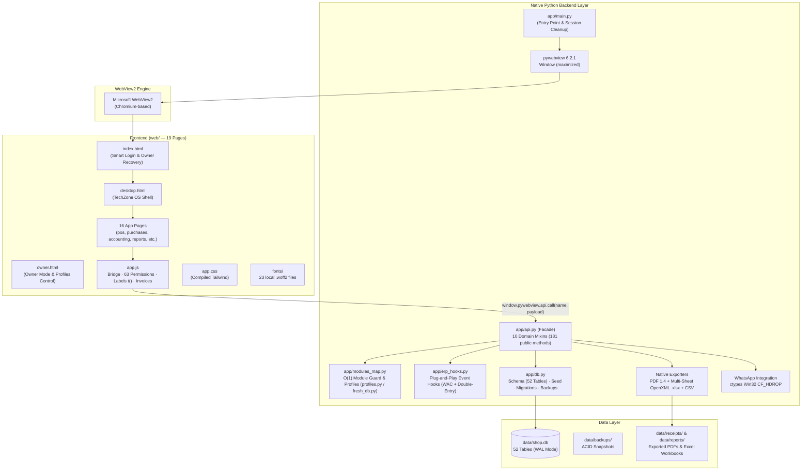

# TechZone POS & ERP — System Architecture

## Overview

TechZone is a fully offline point-of-sale, shop management, procurement (`purchases`), double-entry accounting (`accounting`), and financial analytics (`reports`) operating system purpose-built for Egyptian electronics retailers and general businesses. It runs as a single-window desktop application powered by Python 3.13, `pywebview` 6.2.1 (backed by Microsoft WebView2), and a vanilla HTML/CSS/JS frontend styled with compiled Tailwind CSS. All data lives in a local SQLite database (`data/shop.db` in WAL mode); the application requires zero network connection at runtime.

---

## ⚠️ Mandatory Architectural Principle: Modular Plug-and-Play (هندسة الأقسام المعزولة)

> **Non-Negotiable Rule for All AI Models & Developers:**
> Every module in TechZone OS is designed as an isolated **Plug-and-Play** unit. Any future addition, modification, or removal of a module MUST strictly obey this architecture:

1. **Zero-Overhead Isolation When Disabled:**
   - The system comprises **15 built-in modules** stored in the `modules` table (`pos`, `sales_quotes`, `inventory`, `customers`, `installments`, `purchases`, `accounting`, `history`, `repair`, `buy_used`, `reports`, `staff`, plus core `settings`, `profile`, `receipt`).
   - `Api._module_enabled(module_key)` caches module activation states in memory (`self._modules_cache`) for `O(1)` lookup and invalidates automatically on `module_toggle`, `profile_apply`, or `modules_reset_defaults`.
   - When `purchases` or `accounting` (or any other module) is disabled in `owner.html`, `app/erp_hooks.py` returns immediately on its first line (`if not is_module_active(api, conn, "accounting"): return None`), ensuring **zero SQL queries, zero CPU overhead, and zero side effects** on POS sales, returns, or shifts.
2. **Server-Side Dispatcher Gate (`app/modules_map.py`):**
   - All **181 public API methods** are mapped in `API_MODULE_MAP` or `CORE_METHODS` inside `app/modules_map.py`.
   - `Api.call()` enforces the module guard before method execution, blocking disabled module API calls even for `admin`.
3. **Separated Financial vs. COGS Journal Posting (`app/erp_hooks.py`):**
   - When `accounting` is active, operational events (`on_sale_created`, `on_sale_returned`, `on_installment_created`, `on_repair_delivered`) generate **two distinct, balanced journal entries**:
     1. **Primary Financial Entry (`source_table='sales'`, etc.):** Records the exact invoice total (`Dr Cash/Wallet/AR = Cr Sales Revenue + Cr VAT Output`), so the journal entry amount displayed in the General Journal matches the actual sale invoice 100%.
     2. **Perpetual Inventory Cost Entry (`source_table='sales_cogs'`, etc.):** Separately records `Dr COGS (5101) = Cr Merchandise Inventory (1105)` at historical weighted-average cost (`cost_unit`).
4. **Idempotent Opening Balance Wizard (`accounting_opening_apply`):**
   - `accounting_opening_preview` and `accounting_opening_apply` inspect `journal_entries` for any existing posted entry with `kind='opening' AND status='posted'`. If one exists, the backend blocks re-execution and the UI disables the wizard trigger and displays the existing opening entry metadata to prevent duplicate opening entries.

---

## System Diagram

---

## Frontend Architecture (19 Pages)

| Page | Module Key | Role |
|------|------------|------|
| `index.html` | *(core)* | Smart login screen — PIN auto-detection, force-PIN change, and owner recovery modal |
| `owner.html` | *(core)* | Hidden Owner Control panel — module registry (toggle/reorder/edit/clone/delete), 5 business profiles (`retail_electronics`, `generic_shop`, `restaurant`, `pharmacy`, `enterprise_erp`), custom labels, fresh DB builder & audit log |
| `desktop.html` | *(core)* | TechZone OS shell — dynamic module registry, taskbar, Start menu, Dock, floating windows, desktop icons |
| `pos.html` | `pos` | High-speed retail POS cashier with hardware barcode scanner listener & in-app print preview |
| `sales_quotes.html` | `sales_quotes` | Official B2B A4 sales invoices & price quotations |
| `purchases.html` | `purchases` | Procurement & Suppliers ERP: purchase bills (with landed shipping cost & WAC calculation, 14% VAT input, 1%/3% WHT), purchase orders (`PO`), purchase returns, supplier CRM, supplier payment vouchers (`SPY-`), statements & AP Aging |
| `accounting.html` | `accounting` | Double-Entry Accounting & Finance ERP: 6 tabs (Overview, Operational Expenses, Treasuries & Transfers, Chart of Accounts with Add/Edit/Delete & HTML5 Drag-and-Drop reparenting, General Journal with separated Sale vs. COGS entries & single-entry viewer, Financial Statements + General Ledger, single-run Opening Balance Wizard, and universal A4 printing across all sections) |
| `inventory.html` | `inventory` | Product catalog, stock tracking, serial numbers, and stocktake sheet |
| `customers.html` | `customers` | Customer database, debt totals, and ledger shortcuts |
| `customer_details.html` | `customers` | Individual customer account statement, installment contracts & payment vouchers |
| `installments.html` | `installments` | Installment contracts, pre-sale calculator, payment collections, overdue alerts & WhatsApp reminders |
| `repair.html` | `repair` | Repair/service ticket management & spare parts |
| `buy_used.html` | `buy_used` | Used device purchasing & trade-ins |
| `history.html` | `history` | Unified operations history, returns, and multi-filter ledger |
| `reports.html` | `reports` | Comprehensive Financial & Operational Analytics Hub (5 detailed sub-tabs: Detailed P&L + Invoice/Item Profitability, Customer Receivables & Installments, Supplier Payables & Purchases, Cashflow/Treasuries/Shifts, Inventory Valuation & Movements; with native multi-sheet `.xlsx` export, `.csv` export, `A4 PDF` export, direct `A4` printing, and WhatsApp PDF report sharing) |
| `staff.html` | `staff` | Employee management, 7 job presets, audit log & 63-permission console across 12 groups |
| `settings.html` | `settings` *(core)* | System settings (store info, tax, login mode, invoice studio, and database backups/restore hub) |
| `profile.html` | `profile` *(core)* | Personal profile and per-user desktop preferences |
| `receipt.html` | `receipt` *(core)* | Thermal 80mm & A4 invoice preview, print, and WhatsApp sharing |

---

## Backend Architecture (10 Domain Mixins, 181 Public Methods)

`app/api.py` composes 10 specialized domain mixins:

1. `app/api_common.py` — Shared `_STATE`, money/format helpers, PDF 1.4 generator, Win32 clipboard (`CF_HDROP`), and `customer_ledger` helpers
2. `app/api_auth.py` (`AuthSettingsMixin`) — Login modes, users, 63 permissions/presets/audit, settings & backups
3. `app/api_owner.py` (`OwnerMixin`) — Owner auth, recovery key, module registry CRUD/cloning, 5 business profiles, custom labels, fresh DB builder & audit log
4. `app/api_inventory.py` (`InventoryMixin`) — Categories, products, serials, stock adjustments & cost history
5. `app/api_customers.py` (`CustomersMixin`) — Customer CRM, debt summary, ledger history & payment vouchers
6. `app/api_installments.py` (`InstallmentsMixin`) — Installment contracts, schedules, collections, alerts & WhatsApp reminders
7. `app/api_purchases.py` (`PurchasesMixin`) — Suppliers, purchase orders, purchase invoices (WAC + Landed Cost + VAT/WHT), purchase returns, supplier payments & AP aging
8. `app/api_accounting.py` (`AccountingMixin`) — Chart of Accounts (CRUD + Drag-and-Drop `account_move` + guarded `account_delete`), Journal Entries, Treasuries & Transfers, Expenses & Cost Centers, single-run Opening Balance Wizard, Fiscal Years/Periods, General Ledger, Trial Balance, Income Statement, Balance Sheet & Tax Report
9. `app/api_sales.py` (`SalesMixin`) & `app/api_quotes.py` (`QuotesMixin`) — Shifts (incl. Blind Close), POS checkout, B2B quotations, returns, modifications & WhatsApp PDF sharing
10. `app/api_services.py` (`ServicesMixin`) & `app/api_reports.py` (`ReportsMixin`) — Repairs, used device purchases, daily/monthly reports, `report_comprehensive`, `report_export_excel`, `report_export_pdf` & `whatsapp_send_report`

Supporting modules:
- `app/erp_hooks.py` — Loosely coupled Plug-and-Play hooks (`is_module_active`, `record_wac_and_cost_history`, `reverse_wac_on_purchase_return`, `post_journal_entry`, `reverse_journal_entry`, `rebuild_all_account_balances`, `on_sale_created`, `on_sale_returned`, `on_customer_payment_created`, `on_customer_payment_deleted`, `on_installment_created`, `on_installment_paid`, `on_installment_cancelled`, `on_purchase_posted`, `on_purchase_returned`, `on_supplier_payment_created`, `on_supplier_payment_deleted`, `on_repair_delivered`, `on_used_purchased`, `on_stock_adjusted`, `on_shift_closed`).
- `app/permissions.py` — Canonical **63-permission registry** across **12 groups** and **7 role presets**.
- `app/modules_map.py` — Server-side `API_MODULE_MAP` (181 methods), `CORE_METHODS`, and `MODULE_REQUIRES`.
- `app/profiles.py` — 5 built-in business profiles including `enterprise_erp`.
- `app/fresh_db.py` — Atomic per-profile clean database builder (`build_fresh_profile_db`).
