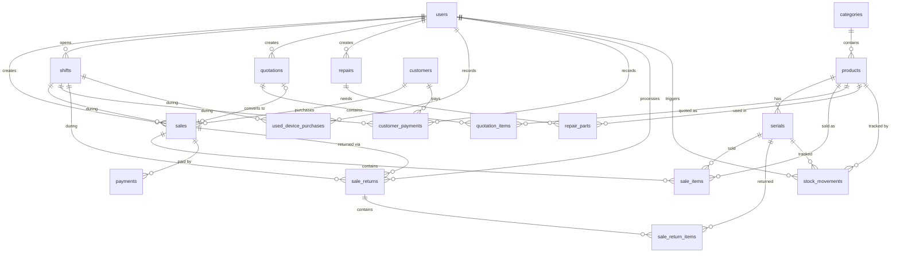

# TechZone POS — Data Model

## Overview

All TechZone data is stored in a single SQLite database at `data/shop.db` (or beside the `.exe` when packaged). The schema comprises **19 tables** managed by `app/db.py`, which handles creation, seeding, and non-destructive auto-migration on every startup.

---

## Conventions

| Convention | Detail |
|------------|--------|
| **Money** | All monetary values (`price`, `cost`, `total`, `amount`, `discount`, `tax`, etc.) are stored as `INTEGER` in **minor units** (qirsh). 1 Egyptian Pound (LE) = 100 qirsh. A product priced at 1 250.50 LE is stored as `125050`. This avoids floating-point rounding errors entirely. |
| **Dates** | All timestamps (`created_at`, `opened_at`, `closed_at`, `updated_at`) are stored as `TEXT` in **ISO 8601** format (`YYYY-MM-DDTHH:MM:SS`), generated by Python's `datetime.isoformat()`. SQLite's date functions work natively on this format. |
| **Images** | Product images and user avatars (`products.image`, `users.avatar`, store logo in `settings`) are stored as `TEXT` containing **base64-encoded data URLs** (`data:image/webp;base64,...`). This keeps the database fully self-contained with no external file references for images. |
| **Booleans** | SQLite has no native boolean type. Boolean columns (`tracked`, `active`) use `INTEGER` with values `0` (false) and `1` (true). |
| **JSON** | The `users.permissions` column and `users.desktop_layout` column store serialised JSON strings. Python's `json.loads()`/`json.dumps()` is used for (de)serialisation. |
| **Primary keys** | Every table uses `id INTEGER PRIMARY KEY AUTOINCREMENT` except `settings`, which uses `key TEXT PRIMARY KEY`. |
| **Foreign keys** | Enforced at the connection level (`PRAGMA foreign_keys = ON`). All `_id` suffix columns reference their parent table's `id`. |

---

## Entity-Relationship Diagram

---

## Table Definitions

### 1. `users`

Stores all system users — both administrators and cashier employees. Each user has unique credentials, a permission set, and personal desktop preferences.

| Column | Type | Constraints | Description |
|--------|------|-------------|-------------|
| `id` | INTEGER | PK, AUTOINCREMENT | Unique user identifier |
| `username` | TEXT | UNIQUE, NOT NULL | Login username (used in `username_password` mode) |
| `name` | TEXT | NOT NULL | Display name shown in taskbar, Start menu, and receipts |
| `role` | TEXT | CHECK(`admin` \| `cashier`) | Determines base privilege level; `admin` bypasses all permission checks |
| `pin_salt` | BLOB | NOT NULL | Random salt for PBKDF2-HMAC-SHA256 PIN hashing |
| `pin_hash` | BLOB | NOT NULL | Derived hash of the user's PIN/password |
| `permissions` | TEXT | DEFAULT `'{}'` | JSON object mapping permission keys to booleans (e.g., `{"pos_sell":true,"cost_view":false}`) |
| `card_size` | TEXT | | Desktop icon card size preference |
| `wallpaper` | TEXT | | Built-in wallpaper identifier for the user's desktop |
| `custom_bg` | TEXT | | Base64 data URL of a user-uploaded custom desktop background |
| `accent_color` | TEXT | | Hex colour code for the user's UI accent colour |
| `desktop_layout` | TEXT | | JSON string encoding desktop icon positions and window states |
| `start_page` | TEXT | | Page to navigate to after login (e.g., `pos.html`, `desktop.html`) |
| `start_mode` | TEXT | | How the start page opens (`desktop` or `direct`) |
| `theme_mode` | TEXT | | `light` or `dark` — persisted per user, synced across all windows |
| `avatar` | TEXT | | Base64 data URL of the user's profile photo |
| `created_at` | TEXT | DEFAULT CURRENT_TIMESTAMP | ISO 8601 account creation time |

**Default seed:** An `admin` user with username `admin`, PIN `0000`, and full permissions is created on first run.

---

### 2. `categories`

Product categories used to organise inventory and filter the POS category bar.

| Column | Type | Constraints | Description |
|--------|------|-------------|-------------|
| `id` | INTEGER | PK, AUTOINCREMENT | Unique category identifier |
| `name` | TEXT | NOT NULL | Category display name (e.g., "لابتوب", "فلاشات", "كاميرات مراقبة") |

**Current categories (12):** اكسسورات كمبيوتر منوعة, كاميرات مراقبة, فارة ولوحة مفاتيح, هاردديسك مكتبي, لابتوب, دي في ار, جهاز مكتبي, فلاشات, كارت ميموري SDC, RAM DESKTOP, شاشات, وغيرها.

---

### 3. `products`

The product catalog. Each product belongs to a category and tracks stock quantities, pricing, and an optional product image.

| Column | Type | Constraints | Description |
|--------|------|-------------|-------------|
| `id` | INTEGER | PK, AUTOINCREMENT | Unique product identifier |
| `sku` | TEXT | | Barcode / SKU (auto-generated if absent during import) |
| `name` | TEXT | NOT NULL | Product display name |
| `category_id` | INTEGER | FK → `categories.id` | Parent category |
| `price` | INTEGER | NOT NULL | Selling price in minor units (qirsh) |
| `cost` | INTEGER | DEFAULT 0 | Purchase cost in minor units |
| `qty` | INTEGER | DEFAULT 0 | Current stock quantity |
| `min_qty` | INTEGER | DEFAULT 0 | Minimum stock threshold for low-stock alerts |
| `tracked` | INTEGER | DEFAULT 0 | `1` = serial-tracked (each unit has a serial); `0` = quantity-based quick sale |
| `image` | TEXT | | Base64 data URL of the product photo (WebP) |
| `notes` | TEXT | | Internal notes |
| `active` | INTEGER | DEFAULT 1 | `0` hides the product from POS and catalog searches |
| `created_at` | TEXT | DEFAULT CURRENT_TIMESTAMP | ISO 8601 creation time |

**Note:** When `tracked = 1`, the POS requires selecting a specific serial from the `serials` table before adding the item to the cart. When `tracked = 0`, the product is sold directly by quantity — no serial lookup needed.

---

### 4. `serials`

Individual serial numbers for serial-tracked products (e.g., laptops, specific devices).

| Column | Type | Constraints | Description |
|--------|------|-------------|-------------|
| `id` | INTEGER | PK, AUTOINCREMENT | Unique serial record identifier |
| `product_id` | INTEGER | FK → `products.id` | Parent product |
| `serial` | TEXT | NOT NULL | The serial number string |
| `status` | TEXT | CHECK(`in_stock` \| `sold` \| `in_repair`) | Current lifecycle state of this unit |
| `created_at` | TEXT | DEFAULT CURRENT_TIMESTAMP | When the serial was registered |

**Status transitions:**
- `in_stock` → `sold` (via sale)
- `sold` → `in_stock` (via sale return)
- `in_stock` → `in_repair` (via repair ticket)
- `in_repair` → `in_stock` (via repair completion)

---

### 5. `shifts`

Cash register shifts. A cashier opens a shift (declaring opening cash) and closes it (counting the drawer). The system calculates the expected cash and difference.

| Column | Type | Constraints | Description |
|--------|------|-------------|-------------|
| `id` | INTEGER | PK, AUTOINCREMENT | Unique shift identifier |
| `user_id` | INTEGER | FK → `users.id` | The user who opened the shift |
| `opened_at` | TEXT | NOT NULL | ISO 8601 shift start time |
| `closed_at` | TEXT | | ISO 8601 shift end time (NULL while open) |
| `opening_cash` | INTEGER | NOT NULL | Cash in drawer at shift start (minor units) |
| `counted_cash` | INTEGER | | Actual cash counted at shift close (minor units) |
| `expected_cash` | INTEGER | | System-calculated expected cash based on transactions (minor units) |
| `diff` | INTEGER | | `counted_cash - expected_cash` — positive = surplus, negative = shortage |

---

### 6. `customers`

Customer records for credit sales (accounts receivable) and repeat-customer tracking.

| Column | Type | Constraints | Description |
|--------|------|-------------|-------------|
| `id` | INTEGER | PK, AUTOINCREMENT | Unique customer identifier |
| `name` | TEXT | NOT NULL | Customer name |
| `phone` | TEXT | | Phone number (used for WhatsApp invoice sending) |
| `created_at` | TEXT | DEFAULT CURRENT_TIMESTAMP | Registration date |

---

### 7. `sales`

Each row is a completed sale (POS or B2B). Links to the cashier, optional customer, and active shift.

| Column | Type | Constraints | Description |
|--------|------|-------------|-------------|
| `id` | INTEGER | PK, AUTOINCREMENT | Unique sale identifier |
| `invoice_no` | TEXT | UNIQUE | Sequential invoice number (prefix from settings, e.g., `INV-00001`) |
| `sale_type` | TEXT | CHECK(`pos` \| `b2b`) | `pos` = point-of-sale transaction, `b2b` = business/quotation-based sale |
| `user_id` | INTEGER | FK → `users.id` | Cashier who processed the sale |
| `customer_id` | INTEGER | FK → `customers.id` | Customer (NULL for anonymous POS sales) |
| `shift_id` | INTEGER | FK → `shifts.id` | Active shift at time of sale |
| `subtotal` | INTEGER | NOT NULL | Sum of line items before discount and tax (minor units) |
| `discount` | INTEGER | DEFAULT 0 | Total discount applied (minor units) |
| `tax` | INTEGER | DEFAULT 0 | Total tax amount — 14% VAT when enabled (minor units) |
| `total` | INTEGER | NOT NULL | Final amount `subtotal - discount + tax` (minor units) |
| `status` | TEXT | | Sale status (e.g., `completed`, `returned`) |
| `notes` | TEXT | | Internal notes |
| `created_at` | TEXT | DEFAULT CURRENT_TIMESTAMP | Sale timestamp |

---

### 8. `sale_items`

Individual line items within a sale. Captures a snapshot of product details at the time of sale (name, SKU, price) so historical records are immune to future product edits.

| Column | Type | Constraints | Description |
|--------|------|-------------|-------------|
| `id` | INTEGER | PK, AUTOINCREMENT | Unique line item identifier |
| `sale_id` | INTEGER | FK → `sales.id` | Parent sale |
| `product_id` | INTEGER | FK → `products.id` | Product sold |
| `serial_id` | INTEGER | FK → `serials.id` | Specific serial unit (NULL if product is not tracked) |
| `name` | TEXT | NOT NULL | Product name snapshot |
| `sku` | TEXT | | SKU/barcode snapshot |
| `qty` | INTEGER | NOT NULL | Quantity sold |
| `price` | INTEGER | NOT NULL | Unit price at time of sale (minor units) |
| `cost` | INTEGER | DEFAULT 0 | Unit cost at time of sale (minor units) — for profit calculation |
| `discount` | INTEGER | DEFAULT 0 | Per-line discount (minor units) |
| `tax` | INTEGER | DEFAULT 0 | Per-line tax (minor units) |
| `total` | INTEGER | NOT NULL | Line total: `(price × qty) - discount + tax` (minor units) |

---

### 9. `payments`

Payment records against a sale. A single sale may have multiple payments (split payment — e.g., part cash, part card).

| Column | Type | Constraints | Description |
|--------|------|-------------|-------------|
| `id` | INTEGER | PK, AUTOINCREMENT | Unique payment identifier |
| `sale_id` | INTEGER | FK → `sales.id` | Parent sale |
| `method` | TEXT | NOT NULL | Payment method name (e.g., "كاش", "فيزا", "فودافون كاش") |
| `amount` | INTEGER | NOT NULL | Amount paid via this method (minor units) |
| `ref_no` | TEXT | | Reference number (card auth code, mobile payment ref, etc.) |
| `created_at` | TEXT | DEFAULT CURRENT_TIMESTAMP | Payment timestamp |

---

### 10. `customer_payments`

Standalone payments from customers against their outstanding balance (accounts receivable). Not tied to a specific sale — these are general credit payments / collection receipts.

| Column | Type | Constraints | Description |
|--------|------|-------------|-------------|
| `id` | INTEGER | PK, AUTOINCREMENT | Unique record identifier |
| `customer_id` | INTEGER | FK → `customers.id` | Customer making the payment |
| `user_id` | INTEGER | FK → `users.id` | Employee who received the payment |
| `shift_id` | INTEGER | FK → `shifts.id` | Active shift at time of collection |
| `amount` | INTEGER | NOT NULL | Amount received (minor units) |
| `method` | TEXT | | Payment method |
| `ref_no` | TEXT | | Reference number |
| `voucher_no` | TEXT | | Receipt/voucher number for the payment |
| `notes` | TEXT | | Collection notes |
| `created_at` | TEXT | DEFAULT CURRENT_TIMESTAMP | Payment timestamp |

---

### 11. `sale_returns`

Return header — records a return event against an original sale.

| Column | Type | Constraints | Description |
|--------|------|-------------|-------------|
| `id` | INTEGER | PK, AUTOINCREMENT | Unique return identifier |
| `sale_id` | INTEGER | FK → `sales.id` | Original sale being returned |
| `user_id` | INTEGER | FK → `users.id` | Employee who processed the return |
| `shift_id` | INTEGER | FK → `shifts.id` | Active shift |
| `total` | INTEGER | NOT NULL | Total refund amount (minor units) |
| `notes` | TEXT | | Return reason / notes |
| `created_at` | TEXT | DEFAULT CURRENT_TIMESTAMP | Return timestamp |

---

### 12. `sale_return_items`

Individual items being returned, referencing the original `sale_items` line.

| Column | Type | Constraints | Description |
|--------|------|-------------|-------------|
| `id` | INTEGER | PK, AUTOINCREMENT | Unique return line identifier |
| `return_id` | INTEGER | FK → `sale_returns.id` | Parent return |
| `sale_item_id` | INTEGER | FK → `sale_items.id` | Original sale line item |
| `product_id` | INTEGER | FK → `products.id` | Product being returned |
| `serial_id` | INTEGER | FK → `serials.id` | Serial unit returned (NULL if not tracked) |
| `qty` | INTEGER | NOT NULL | Quantity returned |
| `amount` | INTEGER | NOT NULL | Refund amount for this line (minor units) |

**Side effects:** On return, `products.qty` is incremented and `serials.status` is set back to `in_stock` for tracked products. A `stock_movements` record is created.

---

### 13. `quotations`

Price quotation / proforma invoice. Can be converted into a real sale.

| Column | Type | Constraints | Description |
|--------|------|-------------|-------------|
| `id` | INTEGER | PK, AUTOINCREMENT | Unique quotation identifier |
| `quote_no` | TEXT | UNIQUE | Sequential quotation number (prefix from settings, e.g., `QT-00001`) |
| `user_id` | INTEGER | FK → `users.id` | Employee who created the quotation |
| `customer_name` | TEXT | | Customer name (free-text, not required to be a registered customer) |
| `customer_phone` | TEXT | | Customer phone |
| `subtotal` | INTEGER | NOT NULL | Sum of quoted items (minor units) |
| `discount` | INTEGER | DEFAULT 0 | Quotation-level discount (minor units) |
| `tax` | INTEGER | DEFAULT 0 | Tax amount (minor units) |
| `total` | INTEGER | NOT NULL | Quoted total (minor units) |
| `status` | TEXT | CHECK(`draft` \| `sent` \| `converted` \| `cancelled`) | Quotation lifecycle |
| `converted_sale_id` | INTEGER | FK → `sales.id` | Links to the sale created when the quotation is converted |
| `notes` | TEXT | | Internal notes |
| `created_at` | TEXT | DEFAULT CURRENT_TIMESTAMP | Creation timestamp |

**Status flow:** `draft` → `sent` → `converted` (creates a sale) or `cancelled`.

---

### 14. `quotation_items`

Line items within a quotation.

| Column | Type | Constraints | Description |
|--------|------|-------------|-------------|
| `id` | INTEGER | PK, AUTOINCREMENT | Unique line identifier |
| `quote_id` | INTEGER | FK → `quotations.id` | Parent quotation |
| `product_id` | INTEGER | FK → `products.id` | Quoted product |
| `name` | TEXT | NOT NULL | Product name snapshot |
| `sku` | TEXT | | SKU snapshot |
| `qty` | INTEGER | NOT NULL | Quoted quantity |
| `price` | INTEGER | NOT NULL | Quoted unit price (minor units) |
| `discount` | INTEGER | DEFAULT 0 | Per-line discount (minor units) |
| `tax` | INTEGER | DEFAULT 0 | Per-line tax (minor units) |
| `total` | INTEGER | NOT NULL | Line total (minor units) |

---

### 15. `used_device_purchases`

Records for buying used/second-hand devices from walk-in sellers. Captures seller identity for legal compliance.

| Column | Type | Constraints | Description |
|--------|------|-------------|-------------|
| `id` | INTEGER | PK, AUTOINCREMENT | Unique purchase identifier |
| `user_id` | INTEGER | FK → `users.id` | Employee who handled the purchase |
| `shift_id` | INTEGER | FK → `shifts.id` | Active shift |
| `seller_name` | TEXT | NOT NULL | Seller's full name |
| `seller_phone` | TEXT | | Seller's phone number |
| `seller_id_number` | TEXT | | National ID number (Egyptian national ID) |
| `device_name` | TEXT | NOT NULL | Device description (e.g., "iPhone 13 Pro 256GB") |
| `serial_number` | TEXT | | Device serial / IMEI |
| `condition` | TEXT | | Device condition notes |
| `purchase_price` | INTEGER | NOT NULL | Amount paid to the seller (minor units) |
| `expected_sell_price` | INTEGER | DEFAULT 0 | Estimated resale price (minor units) |
| `notes` | TEXT | | Additional notes |
| `receipt_no` | TEXT | | Purchase receipt number |
| `created_at` | TEXT | DEFAULT CURRENT_TIMESTAMP | Purchase timestamp |

---

### 16. `repairs`

Service/repair tickets for devices brought in by customers.

| Column | Type | Constraints | Description |
|--------|------|-------------|-------------|
| `id` | INTEGER | PK, AUTOINCREMENT | Unique repair identifier |
| `user_id` | INTEGER | FK → `users.id` | Employee who created the ticket |
| `customer_name` | TEXT | NOT NULL | Customer name |
| `customer_phone` | TEXT | | Customer phone |
| `device_name` | TEXT | NOT NULL | Device description |
| `serial_number` | TEXT | | Device serial / IMEI |
| `accessories` | TEXT | | Accessories received with device (e.g., "charger, case") |
| `issue` | TEXT | | Customer-reported issue |
| `diagnosis` | TEXT | | Technician's diagnosis |
| `cost` | INTEGER | DEFAULT 0 | Repair cost charged to customer (minor units) |
| `status` | TEXT | CHECK(`received` \| `in_review` \| `pending_approval` \| `repaired` \| `delivered` \| `rejected`) | Ticket lifecycle |
| `ticket_no` | TEXT | | Sequential ticket number |
| `notes` | TEXT | | Internal notes |
| `created_at` | TEXT | DEFAULT CURRENT_TIMESTAMP | Ticket creation time |
| `updated_at` | TEXT | | Last status change timestamp |

**Status flow:** `received` → `in_review` → `pending_approval` → `repaired` → `delivered`, or at any point → `rejected`.

---

### 17. `repair_parts`

Parts consumed during a repair, optionally linked to inventory products.

| Column | Type | Constraints | Description |
|--------|------|-------------|-------------|
| `id` | INTEGER | PK, AUTOINCREMENT | Unique record identifier |
| `repair_id` | INTEGER | FK → `repairs.id` | Parent repair ticket |
| `product_id` | INTEGER | FK → `products.id` | Inventory product used (NULL if external part) |
| `name` | TEXT | NOT NULL | Part description |
| `qty` | INTEGER | NOT NULL | Quantity used |
| `cost` | INTEGER | NOT NULL | Cost of this part (minor units) |

When `product_id` is set, stock is decremented from `products.qty` and a `stock_movements` entry is created.

---

### 18. `stock_movements`

Audit trail for every inventory change. Every stock-affecting operation (sale, return, repair part, manual adjustment) creates a movement record.

| Column | Type | Constraints | Description |
|--------|------|-------------|-------------|
| `id` | INTEGER | PK, AUTOINCREMENT | Unique movement identifier |
| `product_id` | INTEGER | FK → `products.id` | Affected product |
| `serial_id` | INTEGER | FK → `serials.id` | Specific serial (NULL for non-tracked products) |
| `qty_change` | INTEGER | NOT NULL | Signed quantity change (`-1` = sold/consumed, `+1` = returned/restocked) |
| `reason` | TEXT | | Human-readable reason (e.g., "بيع", "مرتجع", "تعديل يدوي") |
| `ref_type` | TEXT | | Source entity type (`sale`, `return`, `repair`, `adjustment`) |
| `ref_id` | INTEGER | | Source entity ID (sale_id, return_id, repair_id, etc.) |
| `user_id` | INTEGER | FK → `users.id` | User who triggered the movement |
| `created_at` | TEXT | DEFAULT CURRENT_TIMESTAMP | Movement timestamp |

---

### 19. `settings`

Key-value store for all system-wide configuration.

| Column | Type | Constraints | Description |
|--------|------|-------------|-------------|
| `key` | TEXT | PK | Setting identifier |
| `value` | TEXT | | Setting value (strings, numbers, JSON, or base64 data URLs) |

**Key settings entries:**

| Key | Example Value | Purpose |
|-----|---------------|---------|
| `store_name` | `"تك زون للإلكترونيات"` | Shown in window title, login screen, receipts |
| `store_phone` | `"01234567890"` | Printed on invoices |
| `store_address` | `"القاهرة - مصر"` | Printed on invoices |
| `store_logo` | `"data:image/png;base64,..."` | Store logo for login screen and invoices |
| `tax_enabled` | `"1"` | Enable/disable 14% VAT |
| `tax_rate` | `"14"` | Tax percentage |
| `currency` | `"ج.م"` | Currency symbol |
| `invoice_prefix` | `"INV-"` | Sale invoice number prefix |
| `quote_prefix` | `"QT-"` | Quotation number prefix |
| `receipt_prefix` | `"REC-"` | Receipt number prefix |
| `login_mode` | `"pin_only"` | Login method: `pin_only`, `select_user_pin`, `username_password` |
| `max_login_attempts` | `"5"` | Brute-force protection threshold |
| `lockout_duration` | `"300"` | Lockout duration in seconds after max attempts |
| `a4_template` | `"<html>..."` | Custom A4 invoice HTML template |
| `pos_template` | `"<html>..."` | Custom thermal receipt HTML template |
| `payment_methods` | `'["كاش","فيزا","فودافون كاش"]'` | JSON array of enabled payment methods |
| `pos_categories_config` | `'{"order":[...],"hidden":[...]}'` | POS category bar order and visibility |
| `default_start_page` | `"desktop.html"` | Default page after login for new users |

---

## Access Control Matrix

TechZone enforces **16 granular permissions** checked server-side via `_perm(key)` in `api.py`. The `admin` role bypasses all checks. Cashier permissions are individually toggled per user in `staff.html`.

| Permission Key | Resource / Action | Admin | Cashier (if granted) |
|---------------|-------------------|:-----:|:--------------------:|
| `pos_sell` | Create POS sales | ✅ | ✅ |
| `pos_price` | View/modify prices in POS | ✅ | ✅ |
| `pos_item_discount` | Apply per-item discounts in POS | ✅ | ✅ |
| `sales_return` | Process sale returns | ✅ | ✅ |
| `sales_all` | View all users' sales (not just own) | ✅ | ✅ |
| `inventory_view` | View product catalog and stock levels | ✅ | ✅ |
| `inventory_edit` | Add/edit/delete products and adjust stock | ✅ | ✅ |
| `cost_view` | View product cost prices and profit margins | ✅ | ✅ |
| `customers_view` | View customer list and account statements | ✅ | ✅ |
| `customers_edit` | Add/edit customer records | ✅ | ✅ |
| `customers_delete` | Delete customer records | ✅ | ✅ |
| `repair_view` | View repair tickets | ✅ | ✅ |
| `repair_edit` | Create/edit repair tickets and update status | ✅ | ✅ |
| `used_manage` | Record used device purchases | ✅ | ✅ |
| `reports_view` | Access financial reports and analytics | ✅ | ✅ |
| `settings_manage` | Modify system settings, invoice templates, payment methods | ✅ | ✅ |

> **Note:** The "Cashier" column shows capabilities when the specific permission is granted. By default, a new cashier has **no permissions** — the admin must explicitly enable each one from `staff.html`.

### Access Pattern by Page

| Page | Required Permission(s) | Fallback |
|------|----------------------|----------|
| `index.html` | None (public login) | — |
| `desktop.html` | Any authenticated user | — |
| `profile.html` | Any authenticated user | — |
| `pos.html` | `pos_sell` | Redirected / hidden |
| `sales_quotes.html` | `pos_sell` | Redirected / hidden |
| `history.html` | `pos_sell` or `sales_all` | Shows only own sales |
| `customers.html` | `customers_view` | Redirected / hidden |
| `customer_details.html` | `customers_view` | Redirected / hidden |
| `inventory.html` | `inventory_view` | Redirected / hidden |
| `repair.html` | `repair_view` | Redirected / hidden |
| `buy_used.html` | `used_manage` | Redirected / hidden |
| `receipt.html` | Any authenticated user | — |
| `reports.html` | `reports_view` | Redirected / hidden |
| `settings.html` | `settings_manage` | Redirected / hidden |
| `staff.html` | Admin only (`role = 'admin'`) | Redirected / hidden |

---

## Auto-Migration Strategy

`db.py` uses a non-destructive migration approach on every application startup:

1. For each table, run `PRAGMA table_info(table_name)` to get the current column list.
2. Compare against the expected schema defined in code.
3. For any missing column, execute `ALTER TABLE table_name ADD COLUMN column_name TYPE DEFAULT value`.
4. **No columns are ever dropped or renamed.** This ensures that downgrading or rolling back never causes data loss.
5. New tables are created via `CREATE TABLE IF NOT EXISTS`.
6. Seed data (default admin, default settings, default templates) is inserted only if the respective rows do not already exist (`INSERT OR IGNORE`).

This approach means the database file (`data/shop.db`) is forward-compatible: updating the application binary automatically upgrades the schema without a separate migration tool.

---

## Database File Locations

| Context | `shop.db` Path | `receipts/` Path |
|---------|---------------|-----------------|
| Development | `<project_root>/data/shop.db` | `<project_root>/data/receipts/` |
| Packaged `.exe` | `<exe_directory>/data/shop.db` | `<exe_directory>/data/receipts/` |

The `data/` directory is always resolved relative to the executable (or project root in development), ensuring the database persists across application updates while the `web/` assets can be replaced from `sys._MEIPASS`.

---

## Owner Control & Module Registry Tables (Added 2026-11-16)

| Table | Purpose | Key Columns |
|---|---|---|
| `owner_auth` | Single-row (`id = 1`) owner passphrase & recovery key salted PBKDF2 hashes + persistent lockout state | `pass_hash`, `pass_salt`, `recovery_hash`, `recovery_salt`, `fail_state` |
| `modules` | Database-driven section registry replacing hardcoded `OS_APPS` / `NAV`; stores 13 built-ins + custom clones (`c_<slug>`) | `key`, `title`, `icon`, `color`, `url`, `params`, `perm_keys`, `sort_order`, `enabled`, `is_core`, `is_builtin`, `clone_of` |
| `ui_labels` | Key-value overrides for localized UI terminology (`LABEL_KEYS` allowlist) | `key`, `value` |
| `owner_audit_log` | Immutable log of structural changes made in Owner Mode | `ts`, `action`, `target`, `details` |

Settings keys managed by Owner Mode (outside the `settings_save` allowlist): `business_profile` (default `retail_electronics`), `structure_version`.
